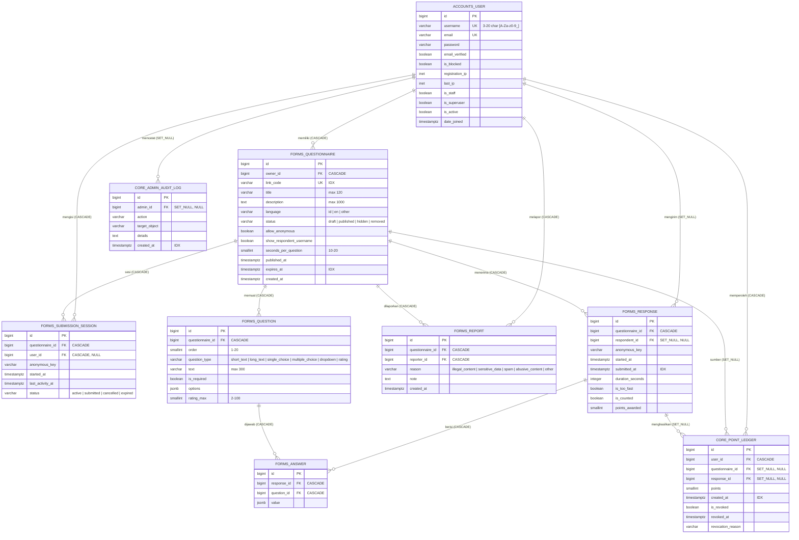

# Skema Database & ERD Terbaru (Sesuai Kode)

Dokumen ini merupakan spesifikasi skema PostgreSQL hasil implementasi model Django di aplikasi `accounts`, `forms_app`, dan `core`.

---

## 1. Entity Relationship Diagram (ERD)

---

## 2. Detail Tabel, Kolom, Tipe Data, dan Relasi

### 2.1 `accounts_user` (Model: `accounts.User`)
| Kolom | Tipe PostgreSQL | Null | Default | Keterangan |
| :--- | :--- | :--- | :--- | :--- |
| `id` | `bigint` (PK) | Tidak | Auto | Primary key |
| `username` | `varchar(20)` | Tidak | - | Unik, regex `^[A-Za-z0-9_]{3,20}$` |
| `email` | `varchar(254)` | Tidak | - | Unik |
| `password` | `varchar(128)` | Tidak | - | Hash bawaan Django |
| `email_verified` | `boolean` | Tidak | `false` | Syarat menerbitkan & mendapat poin |
| `is_blocked` | `boolean` | Tidak | `false` | Pemblokiran oleh admin |
| `registration_ip` | `inet` | Ya | `NULL` | Indeks `idx_user_reg_ip` |
| `last_ip` | `inet` | Ya | `NULL` | IP aktivitas terakhir |
| `date_joined` | `timestamptz` | Tidak | `now()` | Indeks `idx_user_date_joined` (tie-breaker peringkat) |

### 2.2 `forms_questionnaire` (Model: `forms_app.Questionnaire`)
| Kolom | Tipe PostgreSQL | Null | Default | Keterangan |
| :--- | :--- | :--- | :--- | :--- |
| `id` | `bigint` (PK) | Tidak | Auto | Primary key |
| `owner_id` | `bigint` (FK) | Tidak | - | Referensi `accounts_user.id` (`ON DELETE CASCADE`) |
| `link_code` | `varchar(32)` | Tidak | acak URL-safe | Unik + indeks `idx_q_link_code` |
| `title` | `varchar(120)` | Tidak | - | Judul kuesioner |
| `description` | `text` | Tidak | `''` | Maks. 1.000 karakter di validasi form |
| `language` | `varchar(10)` | Tidak | `'id'` | `id`, `en`, `other` |
| `status` | `varchar(20)` | Tidak | `'draft'` | `draft`, `published`, `hidden`, `removed` |
| `allow_anonymous` | `boolean` | Tidak | `true` | Izinkan pengisi tanpa login |
| `show_respondent_username` | `boolean` | Tidak | `false` | Tampilkan username pengisi ke pembuat |
| `seconds_per_question` | `smallint` | Tidak | `10` | Rentang 10–20 detik |
| `published_at` | `timestamptz` | Ya | `NULL` | Waktu terbit |
| `expires_at` | `timestamptz` | Ya | `NULL` | Indeks `idx_q_expires_at` & `idx_q_status_expires` |
| `created_at` | `timestamptz` | Tidak | `now()` | Waktu dibuat |

### 2.3 `forms_question` (Model: `forms_app.Question`)
| Kolom | Tipe PostgreSQL | Null | Default | Keterangan |
| :--- | :--- | :--- | :--- | :--- |
| `id` | `bigint` (PK) | Tidak | Auto | Primary key |
| `questionnaire_id` | `bigint` (FK) | Tidak | - | Referensi `forms_questionnaire.id` (`ON DELETE CASCADE`) |
| `order` | `smallint` | Tidak | - | Urutan 1–20; unik bersama `questionnaire_id` (`uq_question_order_per_questionnaire`) |
| `question_type` | `varchar(20)` | Tidak | - | `short_text`, `long_text`, `single_choice`, `multiple_choice`, `dropdown`, `rating` |
| `text` | `varchar(300)` | Tidak | - | Teks pertanyaan |
| `is_required` | `boolean` | Tidak | `true` | Wajib diisi |
| `options` | `jsonb` | Tidak | `'[]'` | Daftar opsi pilihan |
| `rating_max` | `smallint` | Tidak | `5` | Skala rating 2–100 |

### 2.4 `forms_submission_session` (Model: `forms_app.SubmissionSession`)
| Kolom | Tipe PostgreSQL | Null | Default | Keterangan |
| :--- | :--- | :--- | :--- | :--- |
| `id` | `bigint` (PK) | Tidak | Auto | Primary key |
| `questionnaire_id` | `bigint` (FK) | Tidak | - | Referensi `forms_questionnaire.id` (`ON DELETE CASCADE`) |
| `user_id` | `bigint` (FK) | Ya | `NULL` | Referensi `accounts_user.id` (`ON DELETE CASCADE`) |
| `anonymous_key` | `varchar(64)` | Tidak | `''` | Kunci cookie pengisi anonim |
| `started_at` | `timestamptz` | Tidak | `now()` | Waktu mulai dari server |
| `last_activity_at` | `timestamptz` | Tidak | `now()` | Aktivitas terakhir sesi |
| `status` | `varchar(20)` | Tidak | `'active'` | `active`, `submitted`, `cancelled`, `expired` |

Indeks: `idx_session_user_status` (`user_id, status`), `idx_session_anon_status` (`anonymous_key, status`).

### 2.5 `forms_response` (Model: `forms_app.Response`)
| Kolom | Tipe PostgreSQL | Null | Default | Keterangan |
| :--- | :--- | :--- | :--- | :--- |
| `id` | `bigint` (PK) | Tidak | Auto | Primary key |
| `questionnaire_id` | `bigint` (FK) | Tidak | - | Referensi `forms_questionnaire.id` (`ON DELETE CASCADE`) |
| `respondent_id` | `bigint` (FK) | Ya | `NULL` | Referensi `accounts_user.id` (`ON DELETE SET NULL`) |
| `anonymous_key` | `varchar(64)` | Tidak | `''` | Kunci cookie jika anonim |
| `started_at` | `timestamptz` | Tidak | - | Waktu mulai sesi |
| `submitted_at` | `timestamptz` | Tidak | `now()` | Indeks `idx_resp_submitted_at` |
| `duration_seconds` | `integer` | Tidak | - | Durasi pengerjaan (detik) |
| `is_too_fast` | `boolean` | Tidak | `false` | Dikirim sebelum waktu minimal |
| `is_counted` | `boolean` | Tidak | `false` | Memenuhi seluruh syarat validitas poin |
| `points_awarded` | `smallint` | Tidak | `0` | Poin yang diberikan |

Constraint unik parsial:
- `uq_response_per_user_per_questionnaire`: unik `(questionnaire_id, respondent_id)` saat `respondent_id IS NOT NULL`
- `uq_response_per_anon_per_questionnaire`: unik `(questionnaire_id, anonymous_key)` saat `anonymous_key <> ''`

### 2.6 `forms_answer` (Model: `forms_app.Answer`)
| Kolom | Tipe PostgreSQL | Null | Default | Keterangan |
| :--- | :--- | :--- | :--- | :--- |
| `id` | `bigint` (PK) | Tidak | Auto | Primary key |
| `response_id` | `bigint` (FK) | Tidak | - | Referensi `forms_response.id` (`ON DELETE CASCADE`) |
| `question_id` | `bigint` (FK) | Tidak | - | Referensi `forms_question.id` (`ON DELETE CASCADE`) |
| `value` | `jsonb` | Ya | `NULL` | Isi jawaban (teks, list opsi, atau angka rating) |

Constraint unik: `uq_answer_per_question_per_response` (`response_id, question_id`).

### 2.7 `forms_report` (Model: `forms_app.Report`)
| Kolom | Tipe PostgreSQL | Null | Default | Keterangan |
| :--- | :--- | :--- | :--- | :--- |
| `id` | `bigint` (PK) | Tidak | Auto | Primary key |
| `questionnaire_id` | `bigint` (FK) | Tidak | - | Referensi `forms_questionnaire.id` (`ON DELETE CASCADE`) |
| `reporter_id` | `bigint` (FK) | Tidak | - | Referensi `accounts_user.id` (`ON DELETE CASCADE`) |
| `reason` | `varchar(32)` | Tidak | - | `illegal_content`, `sensitive_data`, `spam`, `abusive_content`, `other` |
| `note` | `text` | Tidak | `''` | Catatan opsional pelapor |
| `created_at` | `timestamptz` | Tidak | `now()` | Waktu laporan |

Constraint unik: `uq_report_per_reporter_per_questionnaire` (`questionnaire_id, reporter_id`).

### 2.8 `core_point_ledger` (Model: `core.PointLedger`)
| Kolom | Tipe PostgreSQL | Null | Default | Keterangan |
| :--- | :--- | :--- | :--- | :--- |
| `id` | `bigint` (PK) | Tidak | Auto | Primary key |
| `user_id` | `bigint` (FK) | Tidak | - | Referensi `accounts_user.id` (`ON DELETE CASCADE`) |
| `questionnaire_id` | `bigint` (FK) | Ya | `NULL` | Referensi `forms_questionnaire.id` (`ON DELETE SET NULL`) |
| `response_id` | `bigint` (FK) | Ya | `NULL` | Referensi `forms_response.id` (`ON DELETE SET NULL`) |
| `points` | `smallint` | Tidak | - | Jumlah poin (1–20) |
| `created_at` | `timestamptz` | Tidak | `now()` | Waktu perolehan |
| `is_revoked` | `boolean` | Tidak | `false` | Penanda pencabutan poin oleh admin |
| `revoked_at` | `timestamptz` | Ya | `NULL` | Waktu pencabutan |
| `revocation_reason` | `varchar(255)` | Tidak | `''` | Alasan pencabutan |

Indeks: `idx_ledger_user_revoked_dt` (`user_id, is_revoked, created_at`).

### 2.9 `core_admin_audit_log` (Model: `core.AdminAuditLog`)
| Kolom | Tipe PostgreSQL | Null | Default | Keterangan |
| :--- | :--- | :--- | :--- | :--- |
| `id` | `bigint` (PK) | Tidak | Auto | Primary key |
| `admin_id` | `bigint` (FK) | Ya | `NULL` | Referensi `accounts_user.id` (`ON DELETE SET NULL`) |
| `action` | `varchar(64)` | Tidak | - | Nama aksi moderasi |
| `target_object` | `varchar(120)` | Tidak | - | Identifikasi objek target |
| `details` | `text` | Tidak | `''` | Rincian tambahan |
| `created_at` | `timestamptz` | Tidak | `now()` | Waktu kejadian |

---

## 3. HANDOFF Model untuk Tim (Anggota 1, 3, 4, 5)

- **Lokasi Model**:
  - `accounts.models.User` (`AUTH_USER_MODEL = 'accounts.User'`)
  - `forms_app.models`: `Questionnaire`, `Question`, `SubmissionSession`, `Response`, `Answer`, `Report`
  - `core.models`: `PointLedger`, `AdminAuditLog`
- **Setup Lokal**:
  1. Salin `.env.example` menjadi `.env` dan isi `DB_PASSWORD` PostgreSQL lokal.
  2. Buat database `respondent_exchange` di PostgreSQL.
  3. Jalankan `pip install -r requirements.txt`, lalu `python manage.py migrate`, lalu `python manage.py seed_demo`.
- **Akun Demo (`seed_demo`)**:
  - Username: `andi_sutanto`, `budi_pratama`, `citra_lestari`, `dewi_anggraini`, `eko_wijaya`
  - Password semua akun demo: `DemoPass123!`
- **Catatan Query Penting**:
  - Kuesioner terbuka di beranda: `Questionnaire.objects.filter(status=Questionnaire.Status.PUBLISHED, expires_at__gt=timezone.now())`
  - Hitung total respons tanpa kolom redundan: `questionnaire.responses.count()` (atau annotate `Count('responses')`).
  - Hitung skor poin: baca dari `PointLedger.objects.filter(is_revoked=False)` (bukan saldo statis).
